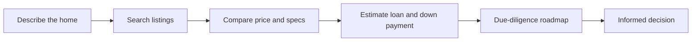

# Khoneyab (خونه‌یاب)

A Persian, RTL assistant for home-buying decisions: from finding real listings to estimating loans and checking a safe path to closing the deal.

For the MVP, Khoneyab focuses on three questions:

1. **Which homes match my needs?** Free-text search or precise filters over stored listings.
2. **Is it financially feasible?** Loan scenarios, monthly installments, loan-certificate costs, down payment and budget gap.
3. **What should I check before paying?** A step-by-step roadmap of legal, technical and contractual inquiries.

Answers come only from available data. The system never fabricates prices, amenities, owners or links; missing values are shown as `null` or with explicit text.

## Product flow



The UI is built with Next.js in RTL and includes light/dark mode, a Persian font, responsive design, built-in icons, loading and empty states, understandable errors and keyboard focus. The conversational chat keeps per-thread filters and uses the same deterministic search engine.

## Project layout

```text
agent/
  home_search/                 home domain: listings, crawler, loans, roadmap, assistant
  graphs/                      chat graph and small nodes
  agent_homes/prompts/         Khoneyab prompts
  job_search/                  legacy JobVision API kept for compatibility
  utilities/                   Persian text, embeddings and usage ledger
ui/
  src/api.py                   FastAPI and Pydantic contracts
  web/                         Next.js page and UI components
configs/                       YAML configuration without secrets
Tests/home_search/             offline tests for the home domain
Tests/job_search/              compatibility tests for the legacy module
docs/home_demo.html            publishable static demo
```

Raw data, models, logs, secrets, caches, binaries and temporary files are not kept in Git. `data/` and `model/` are needed for local runs and are listed in `.gitignore`.

## Quick local start

Prerequisites: Python 3.12, Node.js 22 and Docker Desktop.

```powershell
cd E:\khoneyab
Copy-Item .env.example .env
# Put the real LLM key only in .env; .env is never committed.

.venv\Scripts\python.exe -m pip install -e .

# API
.venv\Scripts\python.exe -m uvicorn ui.src.api:app --host 0.0.0.0 --port 8000

# Web, in a second terminal
cd ui\web
npm ci
npm run dev
```

The web app defaults to `http://localhost:3000` and the API to `http://localhost:8000`. If port 3000 is taken:

```powershell
$env:WEB_PORT="3001"
docker compose up -d --build
```

## Full run with Docker

Before running, copy `.env.example` to `.env` and set real environment values.

```powershell
docker compose config
docker compose up -d --build
docker compose ps
```

| Service | Address | Role |
|---|---|---|
| Web | `http://localhost:3000` | Next.js UI |
| API | `http://localhost:8000` | FastAPI and OpenAPI |
| PostgreSQL | `localhost:5432` | storage ready for state and future migrations |
| Redis | `localhost:6379` | cache and rate limiting |
| Qdrant | `http://localhost:6333/dashboard` | optional vector store |

Compose defines a healthcheck for every service, and the API starts once PostgreSQL, Redis and Qdrant are healthy.

```powershell
docker compose exec redis redis-cli ping
docker compose exec postgres pg_isready -U khoneyab -d khoneyab
Invoke-RestMethod http://localhost:8000/health
Invoke-WebRequest http://localhost:3000 -UseBasicParsing
```

In the MVP, listings are stored in `data/homes/*.jsonl` so the system runs without migrations. `DATABASE_URL` and `REDIS_URL` are ready in Compose, so distributed storage can be added later without changing the API contract.

## API contract

Interactive docs: `GET /docs` — raw schema: `GET /openapi.json`

| Route | Main input | Output |
|---|---|---|
| `GET /homes/search` | `q`, `city`, price/area ranges, `rooms`, `sort`, `limit`, `offset` | results, total count, median price per m² and next page |
| `GET /homes/options` | none | cities and listing count per city |
| `POST /homes/chat` | `{message, thread_id?, filters?, top_k?}` | grounded answer, understood filters and source listings |
| `GET /homes/loans` | `city`, `married` | loan catalog and reference terms |
| `POST /homes/loans/plan` | price, down payment, income, household status and loans | installment, loan share, certificate cost, gap and warnings |
| `GET /homes/roadmap` | none | inquiry steps and sources |
| `GET /health` | none | service status and count of loaded data |

HTTP policy:

- Input models reject unknown fields with `422`.
- Inverted price or area ranges return `422`.
- A missing resource returns `404`; internal errors return `500`.
- Stack traces and secrets are never exposed in public responses.
- Every request gets an `X-Request-ID` header.
- Chat routes are protected by an in-process rate limit; production needs a distributed gateway limit.

Example:

```powershell
Invoke-RestMethod 'http://localhost:8000/homes/search?q=آپارتمان+دوخوابه&city=تهران&limit=12&sort=newest'
```

## Data and accuracy

The crawler runs with an identifying user-agent, a limited rate and respects robots.txt. The output file is replaced atomically, personal contact details are not stored and missing data is never guessed. Loan terms are initial references and must be verified with the bank and notary office.

To build sample local data:

```powershell
.venv\Scripts\python.exe -m agent.home_search.divar_crawler -c tehran -c karaj -p 3
```

For a resumable, target-driven crawl, the crawler saves output atomically after each page:

```powershell
.venv\Scripts\python.exe -m agent.home_search.divar_crawler `
  --target 1000 `
  -c tehran -c karaj -c mashhad -c isfahan `
  --category apartment-sell --category house-villa-sell `
  --max-pages-per-source 20 --delay 1.5
```

`--target` is the number of unique IDs; duplicate rows are dropped and an interrupted run can resume from the same JSONL file.

## Prompt architecture and grounded answers

Prompts live in `agent/agent_homes/prompts/` and are loaded with a shared loader and safe YAML. The pipeline has four stages:

1. **Router** picks only `VectorStore` or `None` using a fixed schema.
2. **Retriever** deterministically parses and ranks the Persian request and keeps `retrieval_note` separate from real Documents.
3. **Quality gate**, when enabled, produces exactly one `isRelevant` per listing; a short or incomplete model answer never drops documents unintentionally.
4. **Generator** sees only the numbered listing text, suggests at most three homes and uses «ذکر نشده» ("not mentioned") for missing data.

Anti-fabrication rules, Persian answer style and legal limits are centralized in `context_rules.yaml`, so policy can change without touching graph logic.

## Testing and quality checks

```powershell
.venv\Scripts\python.exe -m pytest -q
.venv\Scripts\python.exe -m compileall -q agent ui

cd ui\web
npm ci
npm run typecheck
npm run build
```

Tests are offline and use fake HTTP, fake embeddings and in-memory Qdrant; they need no network or model downloads.

## Release checklist

1. Do not ship `.env`, `data/`, `model/` or `logs/`.
2. Run `docker compose config` and the healthchecks.
3. Keep `pytest`, typecheck and build green.
4. Open `/health`, `/docs` and the web page in the target environment.
5. Update loan terms and legal sources before real-world use.

## Stopping and cleaning up locally

```powershell
docker compose down                 # stop services, keep volumes
docker compose down -v              # remove local volumes; back up first
```

Keys stay only in `.env` and must never appear in a commit, issue or README.
